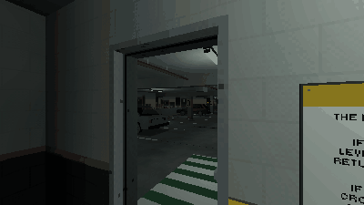

# How to Draw Anomalies Without Repeats in Godot 4

The draw of an anomaly game: which anomaly, if any, a level shows. No anomaly comes twice before every one has come once (a bag that refills only when it is empty, and never with the anomaly just shown), each is picked by its weight, and a ramp makes the obvious ones likelier early in a run and the subtle ones deeper down. The run's first level is always clean, so the player learns the level before anything on it changes.

**Script:** [`anomaly_draw.gd`](anomaly_draw.gd) · Godot 4.3 or newer

## How to use it

1. Copy `anomaly_draw.gd` into your project and make a draw for your loop: `const Draw = preload("res://anomaly_draw.gd")`, then `var draw = Draw.new()`.
2. Fill `draw.anomalies` with your anomalies: anything with an `id`, a `tier` ("S" subtle, "N" noticeable, "O" obvious) and a `weight`, such as your anomaly nodes, or the script's own class: `Draw.Anomaly.new("tyre", "S", 1.0)`.
3. Set `start_level` and `goal_level` to your run (it counts down from the start level to the way out) and `clean_chance`; seed `draw.rng` for a run that repeats.
4. Call `start_run()` when a run starts, and `draw(level)` for each level: it gives the anomaly to show there, or `null` for a clean level.

## What it needs

- Only your anomalies, each with an `id`, a `tier` and a `weight`: the draw is plain GDScript, with no scene or file of a pack.

## Try it free

The [Liminal PSX Parking Anomalies Free Sampler](https://cordatix.itch.io/liminal-psx-parking-anomalies-free) has the looping car park and the pack's loop game, which draws its five anomalies this way on a run of three levels (it also keeps the bag across runs and saves it with the run).

## Tested

In Godot 4.3 and 4.7.2, on stand-in anomalies of the three tiers: a run's first level is clean; no anomaly comes twice before every one has come once, and the refilled bag never starts with the one just shown; an anomaly of weight 0 never comes; clean levels come at `clean_chance`; the ramp makes obvious anomalies likelier on the first levels and subtle ones on the last; a seed repeats a run exactly.

## The devlog and the pack

The step-by-step walkthrough is the devlog [How to Draw Anomalies Without Repeats in Godot 4 (Liminal PSX Parking Anomalies)](https://cordatix.itch.io/liminal-psx-parking-anomalies/devlog/1731759/how-to-draw-anomalies-without-repeats-in-godot-4-liminal-psx-parking-anomalies) on itch.io, written for [Liminal PSX Parking Anomalies](https://cordatix.itch.io/liminal-psx-parking-anomalies), a PS1-style asset pack by [Cordatix](https://cordatix.itch.io) for Godot 4, Unity, Unreal and Blender.

The code is MIT licensed ([LICENSE](../LICENSE)). The pictures show Cordatix asset packs and are not covered by the MIT license.
