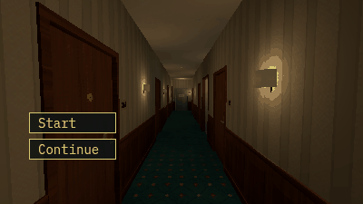

# How to Start an Anomaly Loop Behind a Menu in Godot 4

An anomaly game opens on its title menu with the level already in the scene behind it. This loop does nothing until a run has begun: no floor is entered, no choice made, nobody moved, and the level shows the floor the run will start on, clean. Start begins the run, Continue loads a save, and either may be called before the loop is ready (from a node above it in the tree): the call waits and runs once it is.

**Script:** [`anomaly_loop_menu.gd`](anomaly_loop_menu.gd) · Godot 4.3 or newer

## How to use it

1. Add `anomaly_loop_menu.gd` to a Node in your level and set `level` to your level's node: it needs `show_floor(number, anomaly)` (dress the floor quietly) and `player_on_floor()`.
2. Leave `start_on_ready` off for a game with a menu. Your menu's Start calls `start_run()`; its Continue reads the dictionary `get_save()` gave (JSON in a file) and calls `load_save(data)`.
3. Connect `floor_started` and `entered_floor`: neither comes before a run has begun.
4. For a game without a menu, turn `start_on_ready` on: the run begins at the end of the first frame, and a save loaded in the scene's own `_ready` still wins.

## What it needs

- A level node with `show_floor()` and `player_on_floor()`; the rest of your loop (the stairwells, the move, the choice) goes in `_physics_process` after the guard.

## Try it free

The [Liminal PSX Anomalies Free Sampler](https://cordatix.itch.io/liminal-psx-anomalies-free) has the hotel floor and the pack's loop game, which also does nothing before a run has begun (from version 1.1), with five anomalies on a run of three floors.

## Tested

In Godot 4.3 and 4.7.2, on a stand-in level and menu: the start floor shows clean before a run; nothing is entered before one; Start begins the run once; a save goes through JSON and back; a Continue called from a node above the Loop waits for it; `start_on_ready` alone begins a run, and a save loaded in the scene's `_ready` wins over it.

## The devlog and the pack

The step-by-step walkthrough is the devlog [How to Start an Anomaly Loop Behind a Menu in Godot 4 (Liminal PSX Anomalies)](https://cordatix.itch.io/liminal-psx-anomalies/devlog/1732551/how-to-start-an-anomaly-loop-behind-a-menu-in-godot-4-liminal-psx-anomalies-11) on itch.io, written for [Liminal PSX Anomalies](https://cordatix.itch.io/liminal-psx-anomalies), a PS1-style asset pack by [Cordatix](https://cordatix.itch.io) for Godot 4, Unity, Unreal and Blender.

The code is MIT licensed ([LICENSE](../LICENSE)). The pictures show Cordatix asset packs and are not covered by the MIT license.
