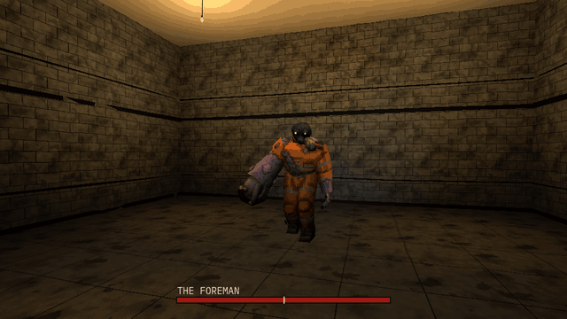

# How to Make a Boss Fight with Phases in Godot 4

A boss fight is a boss that changes: at half its health it fights another way. This script, a Node you add to any animated model, is that core: the boss's health, phases that each begin when the health falls to their share of it, a transition clip the boss cannot be hurt during, and each phase's attacks drawn by weight, never the same one three times running. Its signals tell the rest of the game when a phase begins, an attack starts and the boss is defeated.

**Script:** [`boss_phases.gd`](boss_phases.gd) · Godot 4.3 or newer

## How to use it

1. Add a `Node` as a child of the boss's model, attach `boss_phases.gd` to it and set `anim_path` to the model's `AnimationPlayer`.
2. Edit `phases` in the Inspector, one dictionary a phase: `below` (the share of `max_health` it begins at, 1.0 for the first), `transition` (the clip it plays as it begins, "" for none), `idle` (its clip between attacks) and `attacks` (its attack clips and their weights). Set `death_clip`, and `pause_min` and `pause_max`, the seconds between two attacks. With only two attacks in a phase the never-three-running rule evens their odds out (2 to 1 drew about 1.2 to 1 in the test), so give a phase three or more attacks when their weights matter.
3. From your weapon, call `hit(amount)`: it returns false when the hit did not count (during a transition, or once the boss is dead).
4. Connect `phase_changed(index)`, `attack_started(clip)` and `defeated` for the rest: a health bar, a sound, the music, the arena's doors.

## What it needs

- Godot 4.3 or newer.
- An animated model with an `AnimationPlayer` whose clips are the ones `phases` names: an idle, the attacks, a transition for each later phase, and a death.

## Try it free

The [Cordatix PSX Horror Free Sampler](https://cordatix.itch.io/haunted-psx-free-sampler) has the Offcut, the mini-boss of Cordatix PSX Horror Bosses, with its clips: put `cordatix/psx_horror_bosses/models/offcut.glb` in a scene, add the script under it with `anim_path` on its `AnimationPlayer`, and the script's two example phases (Idle, Attack, Attack2, Scream and Death) play with the Offcut's own clips. The pack's own boss fight kit adds what a whole fight needs: attacks in range only, wind-ups, staggers, a health bar and arenas.

## Tested

In Godot 4.3 and 4.7.2, with the script's two example phases on the free sampler's Offcut as the sampler ships it: it stands in its idle clip, then attacks on its own and never the same attack three times running; the first phase draws its heavier attack more often; a hit counts; under half its health the second phase begins once with its transition clip, and hits do not count while it plays; the second phase draws its own weights; at zero it dies once, its death clip plays and nothing runs after.

## The devlog and the pack

The step-by-step walkthrough is the devlog [How to Make a Boss Fight with Phases in Godot 4 (Cordatix PSX Horror Bosses)](https://cordatix.itch.io/cordatix-psx-horror-bosses/devlog/1739569/how-to-make-a-boss-fight-with-phases-in-godot-4-cordatix-psx-horror-bosses) on itch.io, written for [Cordatix PSX Horror Bosses](https://cordatix.itch.io/cordatix-psx-horror-bosses), a PS1-style asset pack by [Cordatix](https://cordatix.itch.io) for Godot 4, Unity, Unreal and Blender.

The code is MIT licensed ([LICENSE](../LICENSE)). The pictures show Cordatix asset packs and are not covered by the MIT license.
