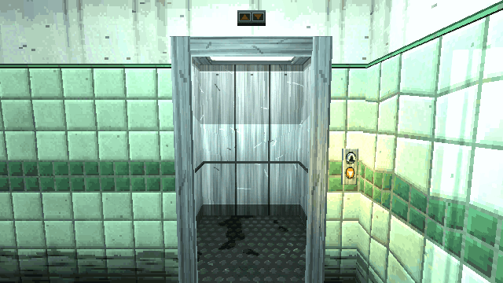

# How to Call a Lift Between Floors in Godot 4

A lift is the quickest way to put a second floor in a horror level, and the easiest to get wrong: a car that leaves with its doors open, or a player who falls through its floor. One script runs it: the car is an AnimatableBody3D, so a player stands in it and rides; each floor's doors slide apart; a call button beside each floor's doors and one in the car call it with E. The doors shut before the car moves and open when it stops. With no models of your own it builds a lift of boxes to try.

**Script:** [`call_a_lift.gd`](call_a_lift.gd) · Godot 4.3 or newer

## How to use it

1. Add a `Node3D` and attach `call_a_lift.gd`. Run the scene: with `car` empty it builds a two-floor lift of boxes, its car on the ground floor.
2. For your own lift, set `car` to an `AnimatableBody3D` (its origin on its floor) and list each floor's doors in `doors`, from the ground up: a `Node3D` with two leaves named `Left` and `Right`. Set `floor_height`, `slide`, `speed`, `door_seconds` and `stay_open`.
3. The buttons are small `Area3D` nodes with `interact(player)`, added by the script beside each floor's doors (`call_button_at`) and in the car (`car_button_at`). Your player's interaction ray calls `interact` on what it hits when E is pressed: give its `RayCast3D` `collide_with_areas`. Or call `call_to(floor)` from your own code; `arrived` fires when the car stops.

## What it needs

- Godot 4.3 or newer (the Compatibility renderer is enough).
- A player that interacts by calling `interact(player)` on what its ray hits, and a `CharacterBody3D` (or any physics body) to ride the car.

## Try it free

The code builds its own lift of boxes, so it runs in any project. The Cordatix PSX Horror Free Sampler has PSX Horror Spaces' 8 free room pieces to build a lobby round it; the lift's doors, car and call panel are in PSX Horror Spaces.

## Tested

In Godot 4.3 and 4.7.2, on its lift of boxes: the ground doors open at the start and shut by themselves; a call from the upper floor shuts the doors before the car moves, and no door opens while it moves; the car rides 4 m up and a CharacterBody3D standing in it rides with it; the upper doors open when it stops and the ground ones stay shut; the car's own button takes it back down.

## The devlog and the pack

The step-by-step walkthrough comes as a devlog on itch.io on 4 December 2026; this README is the tutorial until then. It is written for [PSX Horror Spaces](https://cordatix.itch.io/haunted-psx-spaces), a PS1-style asset pack by [Cordatix](https://cordatix.itch.io) for Godot 4, Unity, Unreal and Blender.

The code is MIT licensed ([LICENSE](../LICENSE)). The pictures show Cordatix asset packs and are not covered by the MIT license.
