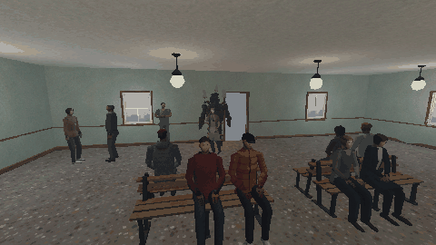

# How to Make a Crowd Flee from a Monster in Godot 4

A monster walks into a crowded room, and nobody moves: the cheapest way to break a horror scene. One script under the monster tells the people who can see it close by to run, the ones further off to start or step back, and lets the panic spread from whoever runs to the people beside them, a moment later. It calls four methods on each person (flee, back_away, startle, calm).

**Script:** [`crowd_flee.gd`](crowd_flee.gd) · Godot 4.3 or newer

## How to use it

1. Add a `Node` under whatever moves as the monster (a `Node3D`: the script only needs where it is) and attach `crowd_flee.gd`.
2. Set `flee_radius` (inside it people run), `notice_radius` (inside it they start or back away), `spread_radius` (how far the panic jumps from a runner, after a short random delay) and `cooldown` (one reaction of a kind per person per cooldown).
3. Give your people `flee`, `back_away`, `startle` and `calm`. Set `need_sight` off for a monster that is heard before it is seen.

## What it needs

- Godot 4.3 or newer (the Compatibility renderer is enough).
- People with four methods: flee, back_away, startle and calm.

## Try it free

The [PSX Bystanders NPC Pack Free Sampler](https://cordatix.itch.io/psx-bystanders-npc-pack-free) has the office worker and the young man with the pack's NPC layer, which has the four methods: the code works on them as they are.

## Tested

In Godot 4.3 and 4.7.2, with the free sampler's two people round a stand-in monster, one of them behind a wall: the two near ones run, the one next to a runner runs a moment after it, the one further off backs away, the one behind the wall and the one far off stay calm, no one reacts the same way twice, and once the monster has gone the people who ran stand again.

## The devlog and the pack

The step-by-step walkthrough comes as a devlog on itch.io on 16 November 2026; this README is the tutorial until then. It is written for [PSX Bystanders NPC Pack](https://cordatix.itch.io/psx-bystanders-npc-pack), a PS1-style asset pack by [Cordatix](https://cordatix.itch.io) for Godot 4, Unity, Unreal and Blender.

The code is MIT licensed ([LICENSE](../LICENSE)). The pictures show Cordatix asset packs and are not covered by the MIT license.
