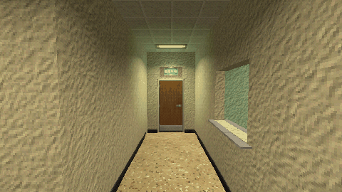

# How to Make Doors Open Away from the Player in Godot 4

A door that swings open away from whoever comes near, from either side. It opens at the same distance from both sides, measured from the doorway's middle, and if the player turns back as it closes, it swings back through the frame out of their way.

**Script:** [`door_open_away.gd`](door_open_away.gd) · Godot 4.3 or newer

## How to use it

1. Give the door scene a child named `Hinge` at the leaf's edge in the doorway, an AnimatableBody3D, and put the leaf's mesh and collision under it: its collision then swings with it and pushes bodies aside.
2. Add `door_open_away.gd` to the door's Node3D. `open_degrees` is the side it opens to by itself, `open_distance` is measured from the doorway's middle.
3. Put the player in the group `player`.

## What it needs

- A door scene built that way; nothing else.

## Try it free

The [Liminal PSX Office Kit - Free Sampler](https://cordatix.itch.io/liminal-psx-office-kit-free) has a wooden office door and a doorway wall to try it on (its own `door.gd` does the same with more options).

## Tested

In Godot 4.3 and 4.7.2, on the free sampler's door: walking and running through it from both sides, and turning back 0 to 0.3 s after it starts to close; each time it opens away from the runner and the leaf never touches them.

## The devlog and the pack

The step-by-step walkthrough is the devlog [How to Make Doors Open Away from the Player in Godot 4 (Liminal PSX Office Kit)](https://cordatix.itch.io/liminal-psx-office-kit/devlog/1723528/how-to-make-doors-open-away-from-the-player-in-godot-4-liminal-psx-office-kit-11) on itch.io, written for [Liminal PSX Office Kit](https://cordatix.itch.io/liminal-psx-office-kit), a PS1-style asset pack by [Cordatix](https://cordatix.itch.io) for Godot 4, Unity, Unreal and Blender.

The code is MIT licensed ([LICENSE](../LICENSE)). The pictures show Cordatix asset packs and are not covered by the MIT license.
