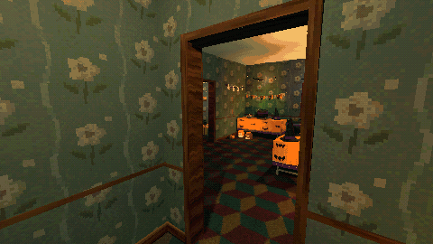

# How to Switch a Room Between Festive and Creepy in Godot 4

Build a Halloween party and what is left when it is over in one scene, and switch between them with one call: each setup is placed twice, each copy in its side's group, and the hidden side is out of sight, physics and processing. Plus swapping one item for its other state, and a flicker that stays within three bright flashes a second.

**Script:** [`festive_creepy.gd`](festive_creepy.gd) · Godot 4.3 or newer

## How to use it

1. `place_setup(name, position, turn)` puts both sides of a setup in the level; `show_side(0)` shows the festive side, `show_side(1)` the creepy one.
2. `creepy_of(variant)` gives an item's other state from the pack's data.
3. `make_flicker(lamp, pattern)` makes any light flicker ("candle", "bulb" or "fluorescent").

## What it needs

- Setups as two scenes each, `<name>__festive.tscn` and `<name>__creepy.tscn`; for `creepy_of`, the pack's `data/props.json`; for `make_flicker`, the series' `flicker_light.gd`.

## Try it free

The [Cordatix PSX Horror Free Sampler](https://cordatix.itch.io/haunted-psx-free-sampler) has a small setup on both sides (`halloween_wall`), 4 decorations, their data and the flicker script.

## Tested

Checked with `godot --headless --check-only` in Godot 4.3 and 4.7.2.

## The devlog and the pack

The step-by-step walkthrough is the devlog [How to Switch a Room Between Festive and Creepy in Godot 4 (Haunted PSX Halloween Takeover)](https://cordatix.itch.io/haunted-psx-halloween-takeover/devlog/1718867/how-to-switch-a-room-between-festive-and-creepy-in-godot-4-haunted-psx-halloween-takeover) on itch.io, written for [Cordatix PSX Horror Halloween Takeover](https://cordatix.itch.io/haunted-psx-halloween-takeover), a PS1-style asset pack by [Cordatix](https://cordatix.itch.io) for Godot 4, Unity, Unreal and Blender.

The code is MIT licensed ([LICENSE](../LICENSE)). The pictures show Cordatix asset packs and are not covered by the MIT license.
