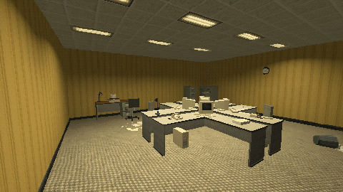

# How to Furnish a Liminal Office in Godot 4

Place ready prop scenes with what stands on a desk at desk height, build a desk corner that turns with its desk, swap a prop for another of its states in place, and let a CharacterBody3D push rigid props.

**Script:** [`furnish_office.gd`](furnish_office.gd) · Godot 4.3 or newer

## How to use it

1. `place(name, position, turn)` puts a prop scene in the level; `desk_corner(position, turn)` a desk with its monitor, keyboard and chair.
2. `swap_state(node, other_state)` swaps a prop for another of its states at the same place.
3. Call `push_bodies(body, speed, delta)` after `move_and_slide()`: a CharacterBody3D does not push rigid bodies by itself.

## What it needs

- Prop scenes whose states share their origin.

## Try it free

The [Liminal PSX Office Props - Free Sampler](https://cordatix.itch.io/liminal-psx-office-props-free) has 8 props in 17 variants: a desk, a swivel chair, a CRT, a keyboard, a phone, a filing cabinet, a water cooler and a waste bin.

## Tested

Checked with `godot --headless --check-only` in Godot 4.3 and 4.7.2.

## The devlog and the pack

The step-by-step walkthrough is the devlog [How to Furnish a Liminal Office in Godot 4 (Liminal PSX Office Props)](https://cordatix.itch.io/liminal-psx-office-props/devlog/1717204/how-to-furnish-a-liminal-office-in-godot-4-liminal-psx-office-props) on itch.io, written for [Liminal PSX Office Props](https://cordatix.itch.io/liminal-psx-office-props), a PS1-style asset pack by [Cordatix](https://cordatix.itch.io) for Godot 4, Unity, Unreal and Blender.

The code is MIT licensed ([LICENSE](../LICENSE)). The pictures show Cordatix asset packs and are not covered by the MIT license.
