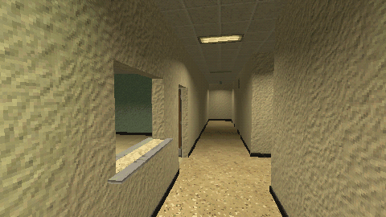

# How to Build a Liminal Office Level with GridMap in Godot 4

Paint a level from 2 m kit pieces with GridMap: 2 x 4 x 2 m cells with Center Y off, one GridMap per layer (floors, ceilings and one per wall direction), a light for every lit piece from the library's metadata, and door scenes in the doorways.

**Script:** [`gridmap_office.gd`](gridmap_office.gd) · Godot 4.3 or newer

## How to use it

1. Add `gridmap_office.gd` to a Node3D and call `build_room(Vector2i(4, 3))`: a room of 4 x 3 cells with rows of ceiling lights and a doorway.
2. `add_lights(grid)` gives every lit piece its light; `add_door(cell, rot_deg)` puts a door scene in a doorway's cell.
3. `LIB` is the path of the MeshLibrary.

## What it needs

- A MeshLibrary of 2 x 2 m pieces with their origin on the floor; for `add_lights`, the light table in its `cordatix_lights` metadata.

## Try it free

The [Liminal PSX Office Kit - Free Sampler](https://cordatix.itch.io/liminal-psx-office-kit-free) has 8 pieces in a MeshLibrary at the path the script uses, with the light table, and the wooden door.

## Tested

Checked with `godot --headless --check-only` in Godot 4.3 and 4.7.2.

## The devlog and the pack

The step-by-step walkthrough is the devlog [How to Build a Liminal Office Level with GridMap in Godot 4 (Liminal PSX Office Kit)](https://cordatix.itch.io/liminal-psx-office-kit/devlog/1716386/how-to-build-a-liminal-office-level-with-gridmap-in-godot-4-liminal-psx-office-kit) on itch.io, written for [Liminal PSX Office Kit](https://cordatix.itch.io/liminal-psx-office-kit), a PS1-style asset pack by [Cordatix](https://cordatix.itch.io) for Godot 4, Unity, Unreal and Blender.

The code is MIT licensed ([LICENSE](../LICENSE)). The pictures show Cordatix asset packs and are not covered by the MIT license.
