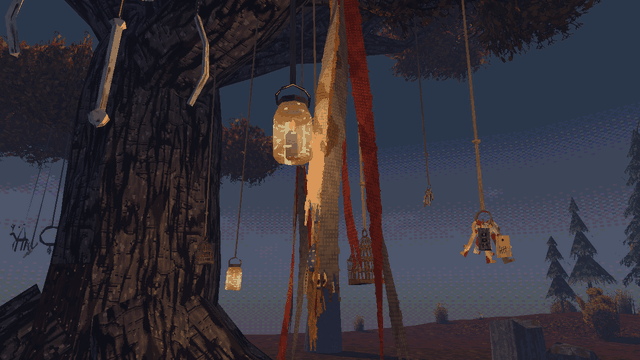

# How to Hang Charms from a Tree That Sway in the Wind in Godot 4

Things hung from a tree are half of a horror forest's mood, and they should move. One script on the tree hangs a charm on a cord at each of its Hang markers and sways them in the stepped wind of PS1 games: every pivot holds still and then jumps, six times a second; a longer cord swings slower and less, and each charm has its own phase, so no two move together. A seed picks the cords, so the same tree hangs the same way every time, and hang() ties one more on at runtime.

**Script:** [`hanging_charms.gd`](hanging_charms.gd) · Godot 4.3 or newer

## How to use it

1. Attach `hanging_charms.gd` to your tree's root (a `Node3D`) and add `Marker3D` children named `Hang...` wherever a cord can be tied: under a limb, at a fork. Any other child is left alone.
2. Fill `charms` with the scenes to hang, one a marker in order: each scene's origin is where the cord ties on, at its top.
3. Set `cord_min` and `cord_max` (metres of cord), `sway_deg`, `wind_speed`, `steps` (poses a second) and `seed`. Call `hang(scene)` or `hang(scene, length)` at runtime for one more; it returns null when every point is taken.

## What it needs

- Godot 4.3 or newer (the Compatibility renderer is enough).
- A tree mesh of any kind, and charm scenes whose origin is at their top.

## Try it free

The code works on any tree and any charms of yours; the Cordatix PSX Horror Free Sampler has seven pieces of the forest but no charms (the offering tree, hung with its twelve kinds of charm, is in PSX Horror Forest).

## Tested

In Godot 4.3 and 4.7.2, with stand-in charms on four markers in any project: every Hang point takes one charm and no other child does; each charm hangs its cord's length under its point; the swing changes six times a second and stays within its degrees, less on a long cord; hang() at runtime takes the free point and then returns null; a length given is used; the same seed hangs the same.

## The devlog and the pack

The step-by-step walkthrough comes as a devlog on itch.io on 26 November 2026; this README is the tutorial until then. It is written for [PSX Horror Forest](https://cordatix.itch.io/cordatix-psx-horror-forest), a PS1-style asset pack by [Cordatix](https://cordatix.itch.io) for Godot 4, Unity, Unreal and Blender.

The code is MIT licensed ([LICENSE](../LICENSE)). The pictures show Cordatix asset packs and are not covered by the MIT license.
