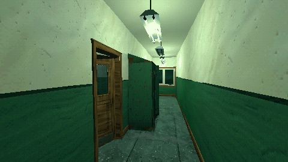
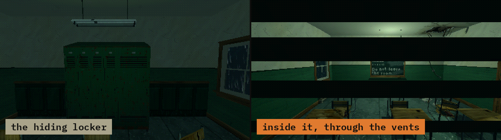

# How to Hide in a Locker in Godot 4

A level script that lets the player hide in a locker and makes a chasing creature lose them. When the door shuts on the player, the creature drops its target and the camera moves to the locker's peek point behind the vents; when the player steps out, both go back. A creature that searches the room can ask whether anyone is inside, pull the door open and give chase.

**Script:** [`locker_hiding.gd`](locker_hiding.gd) · Godot 4.3 or newer

## How to use it

1. Put your lockers in the group `lockers`.
2. Add `locker_hiding.gd` to the level's root Node3D and set `creature` and `camera` in the Inspector.
3. When your creature reaches a locker, call `search(locker, player)`.

## What it needs

- A locker scene with the signals `player_hidden(body)` and `player_left(body)` and the methods `peek_point()` (a Node3D at eye height behind the vents), `is_occupied()` and `interact(by)`. The hiding lockers of Haunted PSX Spaces (`scenes/hiding_locker__<theme>.tscn`) have them; a locker of your own works if it has the same.
- A creature with a `target` property: the script sets it to `null` or to the player.

## Try it free

The lockers come with Haunted PSX Spaces. The [Haunted PSX Free Sampler](https://cordatix.itch.io/haunted-psx-free-sampler) has free room pieces to build the room around them.

## Tested

In Godot 4.3 and 4.7.2, with a stand-in locker that has the signals and methods above: when the player hides, the creature loses its target and the camera moves to the peek point; when the player steps out, the camera is back at the player's eyes and the creature is after them; `search()` opens an occupied locker and sets the creature on the player, and leaves an empty one shut.

## The devlog and the pack

The step-by-step walkthrough is the devlog [How to Hide in a Locker in Godot 4 (Haunted PSX Spaces)](https://cordatix.itch.io/haunted-psx-spaces/devlog/1722819/how-to-hide-in-a-locker-in-godot-4-haunted-psx-spaces) on itch.io, written for [Haunted PSX Spaces](https://cordatix.itch.io/haunted-psx-spaces), a PS1-style asset pack by [Cordatix](https://cordatix.itch.io) for Godot 4, Unity, Unreal and Blender.

The code is MIT licensed ([LICENSE](../LICENSE)). The pictures show Cordatix asset packs and are not covered by the MIT license.
