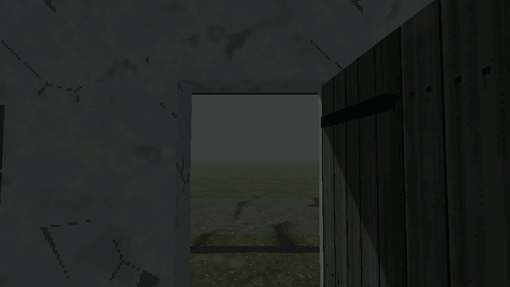

# How to Light Up the House the Player Just Left in Godot 4

An empty village is scariest when it is not quite empty. This script, on a Node3D over your houses, does one thing: the house the player just walked out of lights up behind their back, its windows glowing and a lamp burning inside, and when they come back it goes dark before they reach its door. Each house is a child of the node; its windows are the meshes in the group "window"; its inside is its footprint, a wall's thickness in, at any height. At most a few houses burn at once, the one lit longest going dark first.

**Script:** [`house_left_lit.gd`](house_left_lit.gd) · Godot 4.3 or newer

## How to use it

1. Add a `Node3D` and attach `house_left_lit.gd`. Put each house under it as a child: any `Node3D` with its meshes under it.
2. Put each window's `MeshInstance3D` in the group `window`. The glass is the surface whose name has "glass" in it (a surface named `..._in` is the inside face and stays dark), or the mesh's first.
3. Set `lit_glass` to a glowing material for a lit window (an unshaded or emissive one).
4. Put the player in the group `player`. Its origin may be at its feet: a house's inside is its footprint, `wall` metres in, at any height.
5. Tune `delay` and `leave_distance` (how long and how far out before a house lights), `approach_distance` (how near before it goes dark) and `max_lit`. Call `light(house)`, `darken(house)` or `is_lit(house)` from your own scripts.

## What it needs

- Godot 4.3 or newer.
- Houses as `Node3D`s with their meshes under them, windows' meshes in the group `window`, a player node in the group `player`, and a glowing material.

## Try it free

The [Cordatix PSX Horror Free Sampler](https://cordatix.itch.io/haunted-psx-free-sampler) has a small stone house of Cordatix PSX Horror Village to try it on: its walls with a window and a door, the corner, a 4 m roof and its gable, the floor, the house door and the window in dark, lit and broken glass (`cordatix/psx_horror_village/pieces/`, the lit glass `cordatix/psx_horror_village/materials/vi_glass_window_lit.tres`), the dirt road tile in four looks, and this script as `cordatix/psx_horror_village/sampler/house_left_lit.gd`. V in the sampler's demo room opens its village taste: three houses on a night road under this script. The pack's own empty village adds the street lamps that die as you pass under them, the shutters that bang in a gust, every house the house builder makes and its signals.

## Tested

In Godot 4.3 and 4.7.2, with three houses of stand-in boxes and again with the free sampler's wall, window wall, window and lit glass, the player standing on the floor (its origin at its feet): nothing lights while the player is inside, nor before the delay; the house the player left lights up, its window showing the lit glass on its outside face and a lamp burning inside; it goes dark as the player comes near and its lamp is gone; at most max_lit houses burn, the oldest going dark first.

## The devlog and the pack

The step-by-step walkthrough is the devlog [How to Light Up the House the Player Just Left in Godot 4 (Cordatix PSX Horror Village)](https://cordatix.itch.io/cordatix-psx-horror-village/devlog/1744212/how-to-light-up-the-house-the-player-just-left-in-godot-4-cordatix-psx-horror-village) on itch.io, written for [Cordatix PSX Horror Village](https://cordatix.itch.io/cordatix-psx-horror-village), a PS1-style asset pack by [Cordatix](https://cordatix.itch.io) for Godot 4, Unity, Unreal and Blender.

The code is MIT licensed ([LICENSE](../LICENSE)). The pictures show Cordatix asset packs and are not covered by the MIT license.
