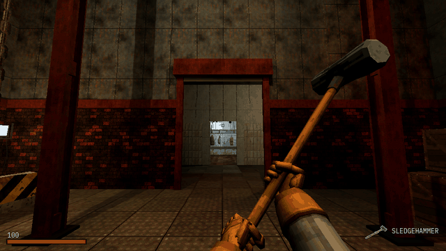

# How to Lock the Player in a Boss Arena in Godot 4

A boss fight starts when the door slams behind you. This script, on an Area3D over the arena's floor, is that moment: the player walks in, the gates drop behind them (solid at once, so nobody slips under) and the boss starts; the boss dies, and the gates rise and stay open; the player dies, and the arena puts everything back as it was before the fight, the player outside the door, so walking in again is the same fight. Its signals tell the rest of the game when the arena seals, when it lets the player go and when the fight starts over.

**Script:** [`boss_arena_lock.gd`](boss_arena_lock.gd) · Godot 4.3 or newer

## How to use it

1. Add an `Area3D` with a `CollisionShape3D` over the arena's floor and attach `boss_arena_lock.gd` to it. Leave the last two metres before the door out of the shape, so the gate drops behind the player, not on them.
2. Place each gate shut in its doorway: any `Node3D` with its collision shapes under it (a `StaticBody3D` with a box will do). List them in `gates`; at the start the script lifts each one by `gate_drop` metres and turns its collision off, and when the player walks in it drops them in `slam_time` seconds, solid from the first frame.
3. Set `boss_path` to the boss: any node with a `died` signal. The script calls its `start(player)` when the arena seals and its `reset()` on a retry, if it has them.
4. Put the player in the `player` group (`player_group`) and give it a `died` signal and a `revive()` method. Set `restart_path` to a `Marker3D` outside the door: `retry_delay` seconds after the player's death, the boss is reset, the gates rise and the player stands at the marker, revived.
5. Connect `sealed`, `released` and `retried` for the rest: the music, alarm lights, a health bar.

## What it needs

- Godot 4.3 or newer.
- A player that is a physics body (a `CharacterBody3D`) in a group, and a boss with a `died` signal. A gate needs nothing but a collision shape under it.

## Try it free

The [Cordatix PSX Horror Free Sampler](https://cordatix.itch.io/haunted-psx-free-sampler) has a small cold store arena of Cordatix PSX Horror Boss Arena to try it in: its floor, its 6 m walls, the wall with the 1 m doorway and the small roll-up shutter's leaf (`cordatix/psx_horror_boss_arena/meshes/parts/shutter_small__coldstore__leaf.tres`). Put that mesh and a `StaticBody3D` with a 1 by 2.1 m box under a `Node3D`, place it shut in the doorway and it is a gate for this script, with `gate_drop` at 2.1. B in the sampler's demo room shows the pack's own lock there: walk in and the shutter slams shut behind you as the Offcut rises. The pack's kit adds gates of every kind (roll-up shutters, drop bars, sluice gates, a freezer door), alarm lights, a lock that waits on every enemy you list, the eight weapons, the player and the HUD.

## Tested

In Godot 4.3 and 4.7.2, with stand-ins for the boss and the player, and the free sampler's shutter leaf as the gate: open at the start; sealed when the player walks in, the gate solid before it is down; the boss started with the player; opened when the boss dies and kept open; on the player's death, after the delay the boss reset, the player revived outside the door and the gate up; walking in again seals it again; a gate turned back on its way up shuts and stays solid.

## The devlog and the pack

The step-by-step walkthrough is the devlog [How to Lock the Player in a Boss Arena in Godot 4 (Cordatix PSX Horror Boss Arena)](https://cordatix.itch.io/cordatix-psx-horror-boss-arena/devlog/1741814/how-to-lock-the-player-in-a-boss-arena-in-godot-4-cordatix-psx-horror-boss-arena) on itch.io, written for [Cordatix PSX Horror Boss Arena](https://cordatix.itch.io/cordatix-psx-horror-boss-arena), a PS1-style asset pack by [Cordatix](https://cordatix.itch.io) for Godot 4, Unity, Unreal and Blender.

The code is MIT licensed ([LICENSE](../LICENSE)). The pictures show Cordatix asset packs and are not covered by the MIT license.
