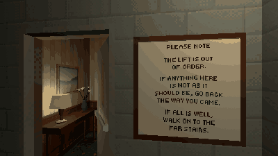

# How to Make a Hallway That Loops for an Anomaly Game in Godot 4

The loop of an anomaly game: one hallway between two stairwells built alike. A flight down either stairwell, out of sight of the hallway, the player is moved to the same place a storey back in the stairwell they came in by, with the same view and speed, so they walk down into the same hallway again. The script says which way they went, and counts a choice only after they have stood in the hallway.

**Script:** [`looping_hallway.gd`](looping_hallway.gd) · Godot 4.3 or newer

## How to use it

1. Build the hallway between two stairwells that look alike from inside, each a stack of the same storey, `storey` metres apart.
2. Put a Node3D marker in each at the same spot (the middle of its door, its +Z into the stairwell): `back` in the one the player comes in by, `on` in the far one. The two only have to look alike, not stand alike.
3. Add `looping_hallway.gd` to a Node in the level and set `player`, `back` and `on` in the Inspector. `inside` is the stairwell's floor in its marker's frame; `cross_depth` is how far below (or above) the hallway's floor the move happens.
4. Connect `chosen(went_on)` to dress the next floor: in an anomaly game, going on is right when nothing was wrong, going back is right when something was.

## What it needs

- A CharacterBody3D player, and two stairwells that look the same wherever the player can see during the move.

## Try it free

The [Liminal PSX Anomalies Free Sampler](https://cordatix.itch.io/liminal-psx-anomalies-free) has the hotel floor, its two stairwells and the pack's full loop game with five anomalies, on a run of three floors (it also waits for both stairwell doors to shut, dresses each floor and writes the floor number on the sign and every door).

## Tested

In Godot 4.3 and 4.7.2, on two markers that face different ways and a capsule player: going on down the far stairwell lands the player a storey up in the near one, at the same place, facing the same way and at the same speed in it, and says `chosen(true)`; back down the near one says `chosen(false)`; climbing moves them a storey down; a player who has not stood in the hallway, or is short of the depth, is not moved.

## The devlog and the pack

The step-by-step walkthrough is the devlog [How to Make a Hallway That Loops for an Anomaly Game in Godot 4 (Liminal PSX Anomalies)](https://cordatix.itch.io/liminal-psx-anomalies/devlog/1729533/how-to-make-a-hallway-that-loops-for-an-anomaly-game-in-godot-4-liminal-psx-anomalies) on itch.io, written for [Liminal PSX Anomalies](https://cordatix.itch.io/liminal-psx-anomalies), a PS1-style asset pack by [Cordatix](https://cordatix.itch.io) for Godot 4, Unity, Unreal and Blender.

The code is MIT licensed ([LICENSE](../LICENSE)). The pictures show Cordatix asset packs and are not covered by the MIT license.
