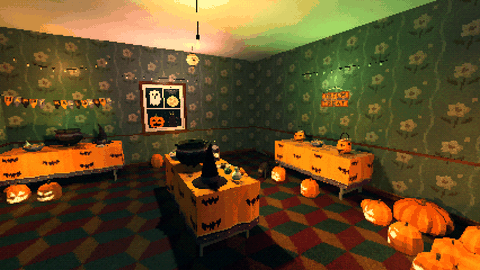

# How to Make a Curse Spread Through a Room in Godot 4

A curse that spreads is scarier than a room that switches at once. The script finds every prop under a room that can still turn (placed as its first state, shown, within a radius if you set one), sorts them by their distance to where the curse starts and swaps each in place for its other state, a fraction of a second apart, with the pack's `cordatix_sides.gd`: same place, parent, name and groups. A signal for each prop is the place for a sound or a flicker of the lights.

**Script:** [`curse_spread.gd`](curse_spread.gd) · Godot 4.3 or newer

## How to use it

1. Add a `Node` to your level and attach `curse_spread.gd`.
2. Set `room` (any node the props are under), `source` (a `Marker3D` where the curse starts) and `pack`: the pack's folder with its trailing slash.
3. Tune `step` (seconds between two props) and `radius` (0: every prop under the room).
4. Call `spread()` when the moment comes: an Area3D the player walks into, an item picked up, a door opened. Connect `turned` and `finished`.

## What it needs

- Godot 4.3 or newer.
- A Cordatix PSX Horror pack that has a switch: its props placed as their own scenes, its `data/props.json` and the series' `cordatix_sides.gd`.

## Try it free

The Cordatix PSX Horror Free Sampler's Halloween decorations (carved pumpkin, string lights, banner, ghost sheet) have their festive and creepy states: set `pack` to `res://cordatix/haunted_psx_halloween_takeover/` and the code works on them as they are. The full pack's are in `res://cordatix/haunted_psx_props/`.

## Tested

In Godot 4.3 and 4.7.2, with the free sampler's decorations: four props at known distances turn, nearest first, each once, into its pair at its place; a hidden one and one already turned stay as they were; `finished` comes once and nothing is left to turn; with a radius only the props within it turn.

## The devlog and the pack

The step-by-step walkthrough is the devlog [How to Make a Curse Spread Through a Room in Godot 4 (Cordatix PSX Horror Props 1.1)](https://cordatix.itch.io/haunted-psx-props/devlog/1765998/how-to-make-a-curse-spread-through-a-room-in-godot-4-cordatix-psx-horror-props) on itch.io, written for [Cordatix PSX Horror Props](https://cordatix.itch.io/haunted-psx-props), a PS1-style asset pack by [Cordatix](https://cordatix.itch.io) for Godot 4, Unity, Unreal and Blender.

The code is MIT licensed ([LICENSE](../LICENSE)). The pictures show Cordatix asset packs and are not covered by the MIT license.
