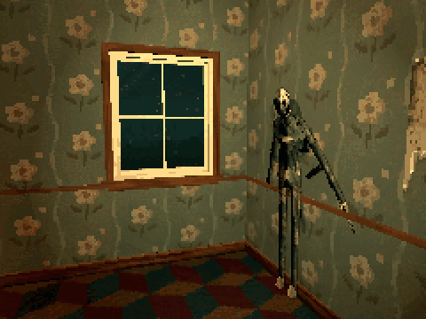

# How to Make a Monster Step Out of a Wall in Godot 4

A monster that waits pressed flat on a wall, steps out of it when the player comes near, and slips back in once the camera sees neither the monster nor its place on the wall. It comes out again only after the player has walked away and come back.

**Script:** [`wall_ambush.gd`](wall_ambush.gd) · Godot 4.3 or newer

## How to use it

1. Make the monster a CharacterBody3D with its model under it, turned to face the body's -Z. The model's AnimationPlayer needs an `Emerge` clip that starts pressed flat on a wall, and an `Idle` clip.
2. Add `wall_ambush.gd` to the CharacterBody3D and stand it with its back to the wall, its origin a few centimetres from the wall's face. `trigger_range` is how near the player must come; `step_out` is how far the Emerge clip carries the body out of the wall.
3. Put the player in the group `player`.

## What it needs

- A rigged monster with those two clips; nothing else.

## Try it free

The [Cordatix PSX Horror Free Sampler](https://cordatix.itch.io/haunted-psx-free-sampler) has Papered, a figure of peeling wallpaper, with all ten of its clips: try the script with it right away.

## Tested

In Godot 4.3 and 4.7.2, with Papered from the free sampler: it waits on its wall, steps out along its facing when the player comes near, plays Idle once out, and slips back when the camera looks away from it and its place.

## The devlog and the pack

The step-by-step walkthrough is the devlog [How to Make a Monster Step Out of a Wall in Godot 4 (Haunted PSX Monsters)](https://cordatix.itch.io/haunted-psx-monsters/devlog/1724922/how-to-make-a-monster-step-out-of-a-wall-in-godot-4-haunted-psx-monsters) on itch.io, written for [Cordatix PSX Horror Monsters](https://cordatix.itch.io/haunted-psx-monsters), a PS1-style asset pack by [Cordatix](https://cordatix.itch.io) for Godot 4, Unity, Unreal and Blender.

The code is MIT licensed ([LICENSE](../LICENSE)). The pictures show Cordatix asset packs and are not covered by the MIT license.
