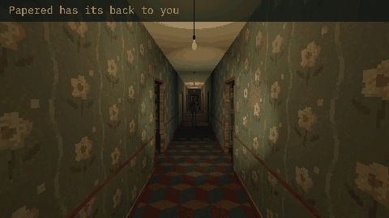

# How to Make a Monster That Hears You Run in Godot 4

A monster that only sees you can be beaten by walking behind it. Give it ears and the player has to choose: sneak past slowly, or run and be heard. One script under the player makes every step a noise that carries further the faster the player moves, nothing at all when sneaking, and divides its reach for every wall between the step and a monster. Each monster it reaches hears it through its hear(position) method.

**Script:** [`footstep_noise.gd`](footstep_noise.gd) · Godot 4.3 or newer

## How to use it

1. Add a `Node` under your player (a `CharacterBody3D`) and attach `footstep_noise.gd`.
2. Set `sneak_speed` (slower is silent), `walk_speed` and `walk_radius`, `run_speed` and `run_radius` (how far a step carries at each pace), `stride` and `run_stride` (a step every so many metres), `land_speed` and `land_radius` (a landing), and `wall_muffle` (each wall divides the reach by it).
3. Put your monsters in `listener_group` with a `hear(position)` method; the monsters of Cordatix PSX Horror Monsters are in `cordatix_monster` and have it. Call `make_noise(position, radius)` for other noises; `noise_made` tells your HUD or sound player.

## What it needs

- Godot 4.3 or newer (the Compatibility renderer is enough).
- A player that is a `CharacterBody3D`, and monsters with a `hear(position)` method.

## Try it free

The Cordatix PSX Horror Free Sampler has Papered with all ten clips and the enemy script, whose `hear(position)` sends it to search where the noise was: the code works on it as it is.

## Tested

In Godot 4.3 and 4.7.2, with Papered of the free sampler standing with its back to the player: sneaking two metres behind it makes no noise; walking is heard two metres away and not five; running is heard eight metres away; through a wall a run is not heard seven metres away and is heard four; landing from a 2 m drop is heard six metres away; a step comes every stride, a still frame now and then not losing it; the monster that hears goes to search towards the step without having seen the player.

## The devlog and the pack

The step-by-step walkthrough comes as a devlog on itch.io on 20 November 2026; this README is the tutorial until then. It is written for [Cordatix PSX Horror Monsters](https://cordatix.itch.io/haunted-psx-monsters), a PS1-style asset pack by [Cordatix](https://cordatix.itch.io) for Godot 4, Unity, Unreal and Blender.

The code is MIT licensed ([LICENSE](../LICENSE)). The pictures show Cordatix asset packs and are not covered by the MIT license.
