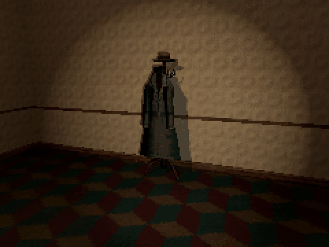

# How to Make Something Move Only When the Player Looks Away in Godot 4

A thing that moves only while nobody looks at it: the player turns round, turns back, and it is nearer, or different, or gone. One script on a Node3D whose children are its states: the first shows, and each time the player has seen it and looks away, the next takes its place. It counts as seen when any of a few points on it is on screen, or just past the edge, with no wall in between.

**Script:** [`look_away_steps.gd`](look_away_steps.gd) · Godot 4.3 or newer

## How to use it

1. Put the states under one Node3D, one child each, in order (for example a coat hanging, a coat worn, a coat nearer, the stand bare).
2. Add `look_away_steps.gd` to that Node3D. `unseen_delay` is how long it must be out of sight before it moves on; `points` are the spots on it the camera checks.
3. Give walls collision on layer 1, and the player's body and the thing's own collision another layer, so only walls block the view.

## What it needs

- A model's states as separate meshes or scenes; nothing else.

## Try it free

The [Silent Dread Free Sampler](https://cordatix.itch.io/silent-dread-free) has Hanging Coat Illusion: its OBJ folder has the four poses (hanging, leaning, closer, gone) to put under the node.

## Tested

In Godot 4.3 and 4.7.2: it never changes while the camera sees it (in view, half behind a wall, glimpsed at the screen's edge), moves one step per look away and only after its delay, counts a wall in the way as not seen, and stops at its last state.

## The devlog and the pack

The step-by-step walkthrough is the devlog [How to Make Something Move Only When the Player Looks Away in Godot 4 (Silent Dread)](https://cordatix.itch.io/silent-dread/devlog/1726836/how-to-make-something-move-only-when-the-player-looks-away-in-godot-4-silent-dread) on itch.io, written for [Silent Dread](https://cordatix.itch.io/silent-dread), a PS1-style asset pack by [Cordatix](https://cordatix.itch.io) for Godot 4, Unity, Unreal and Blender.

The code is MIT licensed ([LICENSE](../LICENSE)). The pictures show Cordatix asset packs and are not covered by the MIT license.
