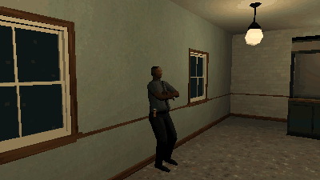

# How to Make NPCs Turn Their Heads to the Player in Godot 4

Background people look alive when they notice you. This script is a SkeletonModifier3D that turns a person's chest, neck and head to the camera when it comes near in front of them, on top of whatever clip plays: the turn shared by the bones (the chest a little, the head most), held within `max_yaw`, never faster than `turn_speed`, and back to the clip's own pose when the camera goes away or behind them.

**Script:** [`npc_head_turn.gd`](npc_head_turn.gd) · Godot 4.3 or newer

## How to use it

1. Add a `SkeletonModifier3D` node as a child of the character's `Skeleton3D` and attach `npc_head_turn.gd` to it (or in code: `skeleton.add_child(preload("npc_head_turn.gd").new())`).
2. Set `bones` to the bones that share the turn and their shares, which add up to 1: by default Godot's humanoid names, `[["Chest", 0.15], ["Neck", 0.35], ["Head", 0.5]]`.
3. Set how far it turns (`max_yaw`, degrees to each side), how fast (`turn_speed`, degrees a second) and from how near (`distance`, metres across the floor); `yaw` holds the turn now, in degrees (left of the face positive).

## What it needs

- Godot 4.3 or newer (SkeletonModifier3D came in 4.3).
- A Skeleton3D with the bones in `bones`, its last one the head, whose +Z is where the face points.
- A current Camera3D: the turn follows the viewport's camera.

## Try it free

The [PSX Bystanders NPC Pack Free Sampler](https://cordatix.itch.io/psx-bystanders-npc-pack-free) has two of the pack's people with every clip, the office worker and the young man: put one's model from `cordatix/psx_bystanders/models/` in a scene, play a clip and add the script under its Skeleton3D. The pack's own NPC layer has a fuller turn of its own (`CordatixBystanderLook`), so the script is for a model without the layer.

## Tested

In Godot 4.3 and 4.7.2, on the free sampler's office worker playing Idle: it turns to a camera 30 degrees to the left until the face is on it, holds at `max_yaw` past it, never turns faster than `turn_speed` when the camera jumps across, goes back to the clip's own pose when the camera is behind or far, and the clip plays on under the turn.

## The devlog and the pack

The step-by-step walkthrough is the devlog [How to Make NPCs Turn Their Heads to the Player in Godot 4 (PSX Bystanders NPC Pack)](https://cordatix.itch.io/psx-bystanders-npc-pack/devlog/1737124/how-to-make-npcs-turn-their-heads-to-the-player-in-godot-4-psx-bystanders-npc-pack) on itch.io, written for [PSX Bystanders NPC Pack](https://cordatix.itch.io/psx-bystanders-npc-pack), a PS1-style asset pack by [Cordatix](https://cordatix.itch.io) for Godot 4, Unity, Unreal and Blender.

The code is MIT licensed ([LICENSE](../LICENSE)). The pictures show Cordatix asset packs and are not covered by the MIT license.
