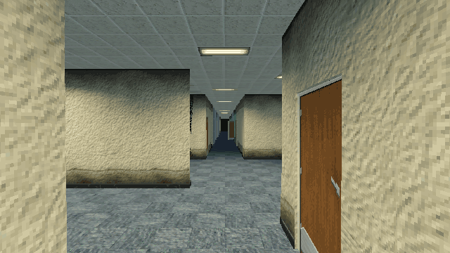

# How to Make an Office Corridor That Never Ends in Godot 4

A corridor that never ends is the backbone of a liminal game, and the easy way to make one, a long level, runs out of memory or out of corridor. One script builds it in segments: the ones ahead of the camera are built, the ones behind are freed, and what each segment holds comes from dice of the seed and its number, so walking back you pass the same doors. With loop_after it comes round to its first segment. With no pieces of your own it builds the corridor of boxes.

**Script:** [`endless_corridor.gd`](endless_corridor.gd) · Godot 4.3 or newer

## How to use it

1. Add a `Node3D`, attach `endless_corridor.gd` and give your scene a `Camera3D` (your player's). Run: with no scenes set it builds the corridor of boxes along +X.
2. For your own pieces set `wall_scene`, `doorway_scene`, `door_scene`, `floor_scene`, `ceiling_scene` and `lamp_scene`: a 2 m grid, the origin at the floor centre of a cell, a wall on the cell's north edge (the Liminal PSX Office Kit free sampler's `wall`, `wall_doorway`, `door_wood`, `floor`, `ceiling` and `ceiling_light` are made so).
3. Set `seed`, `segment_cells`, `ahead`, `behind`, `door_chance` and `loop_after` (0: never repeats).

## What it needs

- Godot 4.3 or newer (the Compatibility renderer is enough).
- A `Camera3D` that moves along +X.

## Try it free

The code builds its own corridor of boxes, so it runs in any project. The Liminal PSX Office Kit Free Sampler has the six pieces it can use; the endless corridor with rooms behind its doors is in Liminal PSX Office Kit.

## Tested

In Godot 4.3 and 4.7.2, on its corridor of boxes: at the start it builds the camera's segment, one behind and two ahead; each cell holds its floor, ceiling and two walls; 200 m on it still holds four segments, the ones behind freed; walking back, a segment is built again the same; the dice give both doors and plain walls; with loop_after 4, segment 5 is segment 1 again. In the free sampler's project, with its six pieces set, they are what it builds.

## The devlog and the pack

The step-by-step walkthrough comes as a devlog on itch.io on 10 December 2026; this README is the tutorial until then. It is written for [Liminal PSX Office Kit](https://cordatix.itch.io/liminal-psx-office-kit), a PS1-style asset pack by [Cordatix](https://cordatix.itch.io) for Godot 4, Unity, Unreal and Blender.

The code is MIT licensed ([LICENSE](../LICENSE)). The pictures show Cordatix asset packs and are not covered by the MIT license.
