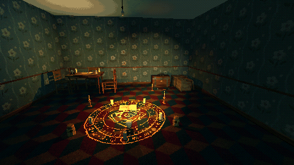
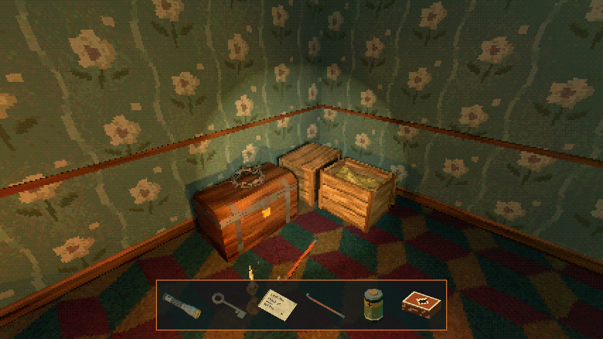

# How to Make Pickups With Inventory Icons in Godot 4

A small, complete pickup and inventory setup: the player keeps a list and answers two calls, `add_item` and `has_item`; a ray from the camera finds what the player looks at; and an inventory bar of 64 px icons redraws itself whenever the list changes.

**Script:** [`pickups_inventory.gd`](pickups_inventory.gd) · Godot 4.3 or newer

## How to use it

1. Put `pickups_inventory.gd` on the player's CharacterBody3D, with a child Camera3D named `Camera3D` and an HBoxContainer at `Hud/Bar` (a CanvasLayer named `Hud` with the bar in it).
2. Bind the key the player uses to the `ui_accept` action, or change it in `_unhandled_input`.
3. A pickup is any node with an `interact(by)` method that calls `add_item` on the player; a lock asks `has_item` before it opens.

## What it needs

- Pickup scenes with `interact(by)`, and their icons.

## Try it free

The [Cordatix PSX Horror Free Sampler](https://cordatix.itch.io/haunted-psx-free-sampler) has 4 of the props as pickups (a candle, a doll, a key and a note) and 5 icons.

## Tested

Checked with `godot --headless --check-only` in Godot 4.3 and 4.7.2.

## The devlog and the pack

The step-by-step walkthrough is the devlog [How to Make Pickups With Inventory Icons in Godot 4 (Haunted PSX Props)](https://cordatix.itch.io/haunted-psx-props/devlog/1719493/how-to-make-pickups-with-inventory-icons-in-godot-4-haunted-psx-props) on itch.io, written for [Cordatix PSX Horror Props](https://cordatix.itch.io/haunted-psx-props), a PS1-style asset pack by [Cordatix](https://cordatix.itch.io) for Godot 4, Unity, Unreal and Blender.

The code is MIT licensed ([LICENSE](../LICENSE)). The pictures show Cordatix asset packs and are not covered by the MIT license.
