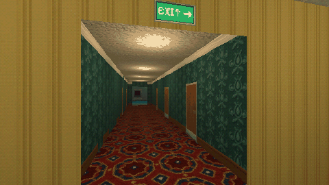

# How to Build a PS1-Style Liminal Room in Godot 4



Five steps to the PS1 look for liminal spaces: import textures lossless with mipmaps, filter them nearest with mipmaps, keep 64 px per metre, light the room like an empty office, and render it at a third of the window size for the PSX look.

**Script:** [`liminal_room.gd`](liminal_room.gd) · Godot 4.3 or newer

## How to use it

1. Set these import defaults in `project.godot`, so Godot does not compress the small palette textures:

```ini
[importer_defaults]

texture={
"compress/mode": 0,
"detect_3d/compress_to": 0,
"mipmaps/generate": true
}
```
2. Take the functions you need from `liminal_room.gd`: `liminal_material(path, size_m)` for a mesh with UVs, `blockout_material(path)` for CSG boxes of any size (world-space, one repeat every 2 m), `ceiling_lamp(position)` and `psx_viewport(world, shrink)`.

## What it needs

- Textures at 64 px per metre: a 128 x 128 px texture covers a 2 x 2 m cell.

## Try it free

The [Liminal PSX Textures - Free Sampler](https://cordatix.itch.io/liminal-psx-textures-free) has 12 of the textures (9 seamless) and a showcase with the PSX shaders.

## Tested

Checked with `godot --headless --check-only` in Godot 4.3 and 4.7.2.

## The devlog and the pack

The step-by-step walkthrough is the devlog [How to Build a PS1-Style Liminal Room in Godot 4 (Liminal PSX Textures)](https://cordatix.itch.io/liminal-psx-textures/devlog/1710627/how-to-build-a-ps1-style-liminal-room-in-godot-4-liminal-psx-textures) on itch.io, written for [Liminal PSX Textures](https://cordatix.itch.io/liminal-psx-textures), a PS1-style asset pack by [Cordatix](https://cordatix.itch.io) for Godot 4, Unity, Unreal and Blender.

The code is MIT licensed ([LICENSE](../LICENSE)). The pictures show Cordatix asset packs and are not covered by the MIT license.
