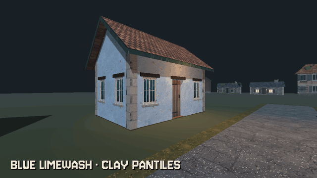

# How to Re-Finish a House in Godot 4

A model's surfaces can carry names, and a name is enough to re-finish a house. An ArrayMesh keeps a name for each surface (a glTF's material names arrive as them, and a modular kit can name each part by its role: an outside wall's face, a roof, a floor). This node, under a house, sets a material on every surface whose name is in its table, and swaps every finished surface from lived in to abandoned with one property, by the materials' file names. The mesh is untouched, so the same piece can wear another finish elsewhere.

**Script:** [`surface_finish.gd`](surface_finish.gd) · Godot 4.3 or newer

## How to use it

1. Add a `Node` under the house (or a row of houses) and attach `surface_finish.gd`; its class is `SurfaceFinish`. It finishes every `MeshInstance3D` under its parent.
2. Name your meshes' surfaces by their role: in Blender the material names your glTF carries, in code `ArrayMesh.surface_set_name()`. Ask a mesh with `mesh.surface_get_name(i)`.
3. Put the materials in one folder, each named `<family>_<state>.tres` (`wall_limewash_blue_lived.tres`, `wall_limewash_blue_abandoned.tres`), and set `folder` to it.
4. Fill `finishes` with surface names to families, e.g. `{"vi_wall_out": "wall_limewash_blue", "vi_roof": "roof_tiles_clay"}`.
5. Set `state` to `lived` or `abandoned`: every finished surface swaps at once. A family with no material for that state is skipped; call `apply()` again after you add meshes.

## What it needs

- Godot 4.3 or newer.
- Meshes whose surfaces carry names (ArrayMesh surface names) and a folder of materials named `<family>_<state>.tres`.

## Try it free

The [Cordatix PSX Horror Free Sampler](https://cordatix.itch.io/haunted-psx-free-sampler) carries this script as `cordatix/psx_horror_village_textures/sampler/surface_finish.gd`, with a small stone cottage of the free village pieces to try it on and 13 of the pack's textures with their materials (a blue limewash wall, clay pantiles, a roller-printed room wall, painted floorboards and a panelled door, in their states, the wall also burnt and the roof also under snow and burnt). M in the sampler's demo room opens its Village Textures taste: the cottage re-finished lived in, abandoned, under snow and burnt. The pack's own re-finish node adds finishes by group, the village's winter and burnt looks, the PSX look and the house builder's houses.

## Tested

In Godot 4.3 and 4.7.2, in the free sampler's project: a wall with a window and a roof end of the free village pieces, the script's table naming the outside wall's face and the roof: they wear the pack's blue limewash and clay pantiles, lived in, and state abandoned swaps both to their abandoned textures.

## The devlog and the pack

The step-by-step walkthrough is the devlog [How to Re-Finish a House in Godot 4 (Cordatix PSX Horror Village Textures)](https://cordatix.itch.io/cordatix-psx-horror-village-textures/devlog/1745146/how-to-re-finish-a-house-in-godot-4-cordatix-psx-horror-village-textures) on itch.io, written for [Cordatix PSX Horror Village Textures](https://cordatix.itch.io/cordatix-psx-horror-village-textures), a PS1-style asset pack by [Cordatix](https://cordatix.itch.io) for Godot 4, Unity, Unreal and Blender.

The code is MIT licensed ([LICENSE](../LICENSE)). The pictures show Cordatix asset packs and are not covered by the MIT license.
