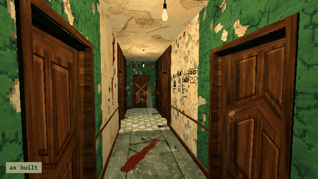

# How to Rot a Room at Run Time in Godot 4

A room that changes while the player is away: when they walk out through the doorway, every surface in it turns from medium to heavy decay, once, so it has rotted when they come back. And a decal, a bloody handprint at its real size, on whatever the camera looks at, facing out of the surface.

**Script:** [`room_rot.gd`](room_rot.gd) · Godot 4.3 or newer

## How to use it

1. Add `room_rot.gd` to a Node3D in the level and set `room` (the node that holds the room's meshes) and `doorway` (an Area3D across the doorway).
2. Put the player in the group `player`.
3. Call `mark_wall(camera)` to put the handprint where the camera looks.

## What it needs

- `decay_swap.gd` and the handprint decal scene from Cordatix PSX Horror Interior Textures, at the paths the script preloads.
- Surfaces whose materials come in pairs, `<family>_medium.tres` and `<family>_heavy.tres`, in that pack's material folders: `decay_swap.gd` swaps one for the other.

## Try it free

The [Cordatix PSX Horror Free Sampler](https://cordatix.itch.io/haunted-psx-free-sampler) has `decay_swap.gd`, the handprint, 4 more decals and 3 of the surfaces in their medium state: the decal works with it, and the swap to heavy needs the full pack's heavy materials.

## Tested

In Godot 4.3 and 4.7.2, in the free sampler's project: leaving through the doorway turns the room's medium surface heavy once, and only for the player (the test adds a heavy material beside the sampler's medium one); `mark_wall` puts the handprint on the wall the camera looks at, facing out.

## The devlog and the pack

The step-by-step walkthrough is the devlog [How to Rot a Room at Run Time in Godot 4 (Haunted PSX Interior Textures)](https://cordatix.itch.io/haunted-psx-interior-textures/devlog/1722195/how-to-rot-a-room-at-run-time-in-godot-4-haunted-psx-interior-textures) on itch.io, written for [Cordatix PSX Horror Interior Textures](https://cordatix.itch.io/haunted-psx-interior-textures), a PS1-style asset pack by [Cordatix](https://cordatix.itch.io) for Godot 4, Unity, Unreal and Blender.

The code is MIT licensed ([LICENSE](../LICENSE)). The pictures show Cordatix asset packs and are not covered by the MIT license.
