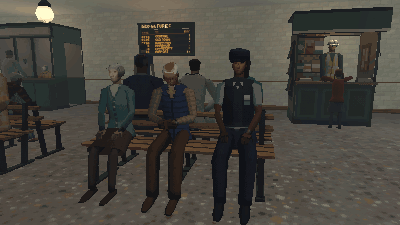

# How to Seat Two NPCs on a Bench and Have Them Talk in Godot 4

A pair on a bench is the cheapest life a level can have. One script seats two people on two markers, gives them turns to talk (one plays a seated talking clip while the other listens) and turns their heads to each other with a SkeletonModifier3D that runs after the clips, so the turn adds to whatever the clip does: within a limit, at a limited speed, shared between chest, neck and head.

**Script:** [`bench_talk.gd`](bench_talk.gd) · Godot 4.3 or newer

## How to use it

1. Add a `Node` and attach `bench_talk.gd`. Set `people` to two characters (each with an AnimationPlayer that has `Sit` and `SitTalk`, and a Skeleton3D with Chest, Neck and Head bones; their front +Z, as a GLB has it).
2. Set `seats` to two markers (`Marker3D`) where the feet go, their -Z the way the people face.
3. Tune `turn` (each turn's length, from x to y seconds), `max_yaw` (degrees) and `turn_speed` (degrees a second).
4. Connect `turn_changed` (the talker's index) for voices or subtitles.

## What it needs

- Godot 4.3 or newer (SkeletonModifier3D; the Compatibility renderer is enough).
- Two rigged characters with a seated clip and a seated talking clip.

## Try it free

The [PSX Bystanders NPC Pack Free Sampler](https://cordatix.itch.io/psx-bystanders-npc-pack-free) has the office worker and the young man with every clip, Sit and SitTalk among them, and the station bench: the code works on them as they are.

## Tested

In Godot 4.3 and 4.7.2, with the free sampler's two people on its station bench: each sits on their seat, the hips on it; one talks while the other listens; both get turns, each within the times set; each head turns to the other, never past `max_yaw`, never faster than `turn_speed`.

## The devlog and the pack

The step-by-step walkthrough is the devlog [How to Seat Two NPCs on a Bench and Have Them Talk in Godot 4 (PSX Bystanders NPC Pack 2.0)](https://cordatix.itch.io/psx-bystanders-npc-pack/devlog/1766079/how-to-seat-two-npcs-on-a-bench-and-have-them-talk-in-godot-4-psx-bystanders-npc-pack) on itch.io, written for [PSX Bystanders NPC Pack](https://cordatix.itch.io/psx-bystanders-npc-pack), a PS1-style asset pack by [Cordatix](https://cordatix.itch.io) for Godot 4, Unity, Unreal and Blender.

The code is MIT licensed ([LICENSE](../LICENSE)). The pictures show Cordatix asset packs and are not covered by the MIT license.
