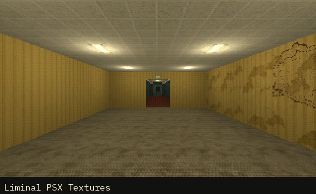

# How to Use Several PSX Asset Packs in One Godot 4 Project

Asset packs from one maker are made to sit together, but each comes as its own Godot project, and that project's settings are part of how its pack looks. The packs' folders copy into one project, and this script, a SceneTree run once from the command line, sets what they ask of it: the Compatibility renderer's light limits (raised, never lowered), decals and light projectors filtered nearest like every texture of the PS1 look, and navigation cells as small as the monsters' navigation meshes. It saves `project.godot`, and a second run changes nothing.

**Script:** [`cordatix_project_setup.gd`](cordatix_project_setup.gd) · Godot 4.3 or newer

## How to use it

1. Copy each pack's `cordatix` folder onto your project's, the oldest pack first: a file two packs share is the same in both, or newer in the newer pack, so let a file replace the one of the same name.
2. Put `cordatix_project_setup.gd` in your project's folder and, with the project closed in the editor (an open editor can save its own copy of the settings over the script's), run it once from there: `godot --headless --path . -s res://cordatix_project_setup.gd`. On Windows, give the full path of the Godot executable; its _console.exe shows what the script prints.
3. Open the project and let Godot import everything. Godot 4.3 can import a model before the textures its material uses when many packs come in at once ("Failed loading resource" in the Output): select that model's .glb and click Reimport in the Import dock.
4. For other packs, change `AT_LEAST` (settings that only rise) and `EXACTLY` (settings set as given).

## What it needs

- Godot 4.3 or newer, from the command line: the script is a SceneTree run with `-s`.
- Packs that keep their files in folders of their own, as the Cordatix packs do (`res://cordatix/<pack>/`, and `res://cordatix/shared/` for what they share).

## Try it free

The script needs no pack: any Godot 4 project takes it. The free samplers keep the packs' layout, so they go in one project the same way, oldest first; the [Cordatix Sampler Box](https://cordatix.itch.io/cordatix-sampler-box) holds every one.

## Tested

In Godot 4.3 and 4.7.2: on fresh projects it sets every value and keeps the project's own settings, a second run leaves the file as it was, higher light limits stay and a lower one rises. The eight free samplers in one project: their 77 scripts and 209 scenes load and each sampler's demo runs (in Godot 4.3, PSX Bystanders' props and the PSX Horror sampler's Offcut can come in before their textures on the first import: reimported, as the third step says, they wear their materials). The 13 packs of Cordatix PSX Mega Pack in one project: their 177 scripts and 1,126 scenes load and each pack's demo runs.

## The devlog and the pack

The step-by-step walkthrough is the devlog [How to Use Several PSX Asset Packs in One Godot 4 Project (Cordatix PSX Mega Pack)](https://cordatix.itch.io/cordatix-psx-mega-pack/devlog/1738246/how-to-use-several-psx-asset-packs-in-one-godot-4-project-cordatix-psx-mega-pack) on itch.io, written for [Cordatix PSX Mega Pack](https://cordatix.itch.io/cordatix-psx-mega-pack), a PS1-style asset pack by [Cordatix](https://cordatix.itch.io) for Godot 4, Unity, Unreal and Blender.

The code is MIT licensed ([LICENSE](../LICENSE)). The pictures show Cordatix asset packs and are not covered by the MIT license.
