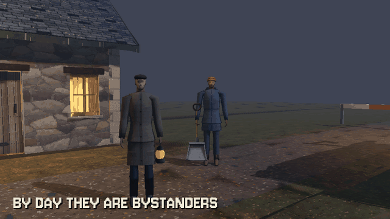

# How to Turn an NPC into an Enemy at Nightfall in Godot 4

The scariest enemy is the one the player walked past an hour ago. A villager is two instances of one model: Day, an ordinary person with its day clips, and Night, the enemy; only one shows at a time. When the darkness from your sky passes `turn_at`, the day body plays Turn, a clip made to end on the night body's first Idle frame, and on that last frame the night body takes its place in the same pose. At dawn the day body steps back in; a hidden body is also stopped, so it costs nothing.

**Script:** [`night_turn.gd`](night_turn.gd) · Godot 4.3 or newer

## How to use it

1. Add a `Node3D` and attach `night_turn.gd`. Give it two children, `Day` and `Night`: two instances of one villager's model, each with its own AnimationPlayer.
2. The model's clips: the day's (`Day_Idle` by default), `Turn`, which ends on the night's first Idle frame, and the night's (`Idle`). Rename them in `day_idle`, `turn_clip` and `night_idle`.
3. Set `darkness` from your sky, 0 by day to 1 at night. The villager turns at `turn_at` and comes back at `dawn_at`; in between it stays as it is, so a cloud over the moon does not flip it.
4. Connect `turned` (true at nightfall, false at dawn) and give the night body your enemy script.

## What it needs

- Godot 4.3 or newer (the Compatibility renderer is enough).
- A rigged character with day clips, a Turn clip and night clips on one skeleton.

## Try it free

The [PSX Bystanders NPC Pack Free Sampler](https://cordatix.itch.io/psx-bystanders-npc-pack-free) has the NPC layer the day body runs on; the villagers themselves, with their day clips, Turn and the night's, are the Villagers bonus in PSX Bystanders NPC Pack. The script works on any rigged character with a day Idle, a Turn and a night Idle on one skeleton.

## Tested

In Godot 4.3 and 4.7.2, with the ploughman of the Villagers bonus: by day the day body shows; in the dark it plays Turn and the night body takes over in the same pose; at dawn the day body is back; the signal fires both ways.

## The devlog and the pack

The step-by-step walkthrough comes as a devlog on itch.io on 1 December 2026; this README is the tutorial until then. It is written for [PSX Bystanders NPC Pack](https://cordatix.itch.io/psx-bystanders-npc-pack), a PS1-style asset pack by [Cordatix](https://cordatix.itch.io) for Godot 4, Unity, Unreal and Blender.

The code is MIT licensed ([LICENSE](../LICENSE)). The pictures show Cordatix asset packs and are not covered by the MIT license.
